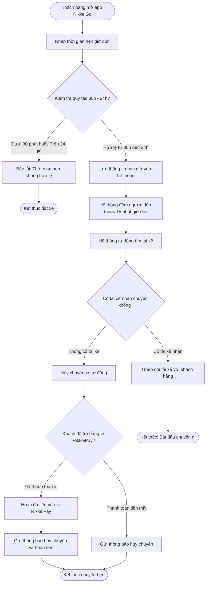

# BÁO CÁO PHÂN TÍCH VÀ THIẾT KẾ ACCEPTANCE CRITERIA CHO CHỨC NĂNG HẸN GIỜ ĐẶT XE RIKKEIGO

> 👤 **Học viên:** Đỗ Hoàng Sơn | **Mã SV:** PTIT-HCM-066
> 🏫 **Môn học:** IT206-K25-Agile-va-Scrum

---

## 📊 Sơ đồ thiết kế hệ thống (Activity Diagram)

> 💡 *Sơ đồ dưới đây được render tự động trực tiếp trên GitHub bằng Mermaid. Bạn cũng có thể tải file **`bt3.drawio`** trong repository này để mở và chỉnh sửa trực tiếp trên [Draw.io (diagrams.net)](https://app.diagrams.net).* 

---

## Nhiệm vụ 1: Phân tích Kịch bản Nghiệm thu

Trong buổi Backlog Refinement cùng Đức (Product Owner), tôi đã tiến hành phân tích story 'Là một Khách hàng, tôi muốn hẹn giờ đặt xe trước, để không trễ chuyến bay'. Dựa trên quy tắc nghiệp vụ và các bẫy dữ liệu biên, tôi đã xây dựng bảng liệt kê 4 kịch bản nghiệm thu chính bao gồm luồng thành công và các trường hợp ngoại lệ liên quan đến thời gian hẹn cũng như trạng thái thanh toán khi không tìm được tài xế.

- Kịch bản 1 xét luồng chuẩn: Khách hàng đặt xe với thời gian hợp lệ trong khoảng từ 30 phút đến 24 giờ và hệ thống tìm thành công tài xế khi đến thời điểm 15 phút trước giờ đón.
- Kịch bản 2 xét trường hợp biên về thời gian: Khách hàng nhập thời gian hẹn sát ranh giới không hợp lệ (ví dụ chỉ cách lúc đặt 20 phút) để kiểm tra khả năng từ chối ngay lập tức của hệ thống.
- Kịch bản 3 xét trường hợp không tìm thấy tài xế và khách hàng chọn thanh toán bằng tiền mặt.
- Kịch bản 4 xét trường hợp không tìm thấy tài xế nhưng khách hàng đã thanh toán trước qua ví điện tử RikkeiPay, yêu cầu kích hoạt cơ chế hoàn tiền tự động.

| Kịch bản | Trạng thái ban đầu | Hành động / Sự kiện | Kết quả mong đợi |
| --- | --- | --- | --- |
| 1. Luồng chính thành công | Khách hàng ở màn hình đặt xe | Chọn hẹn giờ cách thời điểm hiện tại 2 tiếng, hệ thống đếm ngược đến trước 15 phút và tìm thấy tài xế | Hệ thống ghép đôi thành công tài xế với khách hàng, chuyến đi được xác nhận. |
| 2. Biên thời gian không hợp lệ | Khách hàng ở màn hình đặt xe | Chọn hẹn giờ chỉ cách thời điểm hiện tại 20 phút (vi phạm quy tắc dưới 30 phút) | Hệ thống chặn lại, hiển thị thông báo lỗi 'Thời gian hẹn phải từ 30 phút đến 24 giờ tới'. |
| 3. Không có tài xế - Tiền mặt | Đã đến thời điểm tìm tài xế (trước 15 phút), khách chọn trả tiền mặt | Hệ thống phát lệnh tìm tài xế trong 15 phút nhưng không có tài xế nào nhận chuyến | Hệ thống tự động hủy chuyến, gửi thông báo xin lỗi đến khách hàng và đóng lịch hẹn. |
| 4. Không có tài xế - Ví điện tử | Đã đến thời điểm tìm tài xế, khách đã thanh toán trước qua ví RikkeiPay | Hệ thống tìm kiếm không thành công trong thời gian quy định | Hệ thống tự động hủy chuyến, hoàn đủ 100% số tiền vào ví RikkeiPay và gửi thông báo số dư về cho khách. |

## Nhiệm vụ 2: Thiết kế Acceptance Criteria (Given - When - Then)

Dựa trên bảng phân tích kịch bản ở trên, tôi đã biên soạn bộ Acceptance Criteria chi tiết theo chuẩn Given - When - Then để đưa vào User Story, đảm bảo đội ngũ Developer và QA có tiêu chí rõ ràng trước khi đưa vào Sprint Backlog.

- AC 1 (Luồng chuẩn đặt lịch hẹn thành công): Given Khách hàng đang ở màn hình đặt xe RikkeiGo, When Khách hàng chọn tính năng hẹn giờ và thiết lập thời gian đón cách thời điểm hiện tại là 2 giờ, đồng thời bấm xác nhận đặt xe, Then Hệ thống lưu lại lịch hẹn, hiển thị trạng thái chờ đến trước 15 phút giờ hẹn, và khi đến thời điểm đó, hệ thống tự động tìm kiếm tài xế thành công, ghép đôi chuyến đi cho khách.
- AC 2 (Kiểm tra biên thời gian quá gần): Given Khách hàng đang thao tác trên màn hình hẹn giờ đặt xe, When Khách hàng nhập thời gian hẹn chỉ cách thời điểm hiện tại 20 phút (vi phạm mức tối thiểu 30 phút), Then Hệ thống từ chối lưu lịch hẹn và hiển thị thông báo lỗi 'Thời gian hẹn phải cách lúc đặt ít nhất 30 phút'.
- AC 3 (Kiểm tra biên thời gian quá xa): Given Khách hàng đang thao tác trên màn hình hẹn giờ đặt xe, When Khách hàng nhập thời gian hẹn cách thời điểm hiện tại 25 giờ (vi phạm mức tối đa 24 giờ), Then Hệ thống từ chối lưu lịch hẹn và hiển thị thông báo lỗi 'Thời gian hẹn không được vượt quá 24 giờ'.
- AC 4 (Không tìm được tài xế với phương thức thanh toán tiền mặt): Given Khách hàng đã đặt lịch hẹn trước thành công với hình thức thanh toán tiền mặt, When Hệ thống kích hoạt tìm kiếm tài xế trước 15 phút nhưng không có tài xế nào nhận chuyến cho đến sát giờ khởi hành, Then Hệ thống tự động hủy chuyến xe, ghi nhận trạng thái 'Đã hủy do không có tài xế' và gửi thông báo đẩy đến điện thoại của khách hàng.
- AC 5 (Không tìm được tài xế với phương thức thanh toán ví RikkeiPay): Given Khách hàng đã đặt lịch hẹn trước và hoàn tất thanh toán trước qua ví điện tử RikkeiPay, When Hệ thống đến thời điểm tìm tài xế nhưng không thể kết nối với bất kỳ tài xế nào, Then Hệ thống tự động hủy chuyến, lập tức hoàn trả toàn bộ số tiền thanh toán vào ví RikkeiPay của khách hàng, đồng thời gửi thông báo chi tiết về việc hủy chuyến và số tiền đã được hoàn vào ví.

---

## 📁 Danh sách tệp tin nộp bài trong Repository
- 📝 `bt3.docx`: Báo cáo tài liệu phân tích nghiệp vụ hoàn chỉnh.
- 🎨 `bt3.drawio`: File thiết kế sơ đồ chuẩn theo quy định đề bài (mở trực tiếp bằng [Draw.io](https://app.diagrams.net) hoặc Lucidchart).
